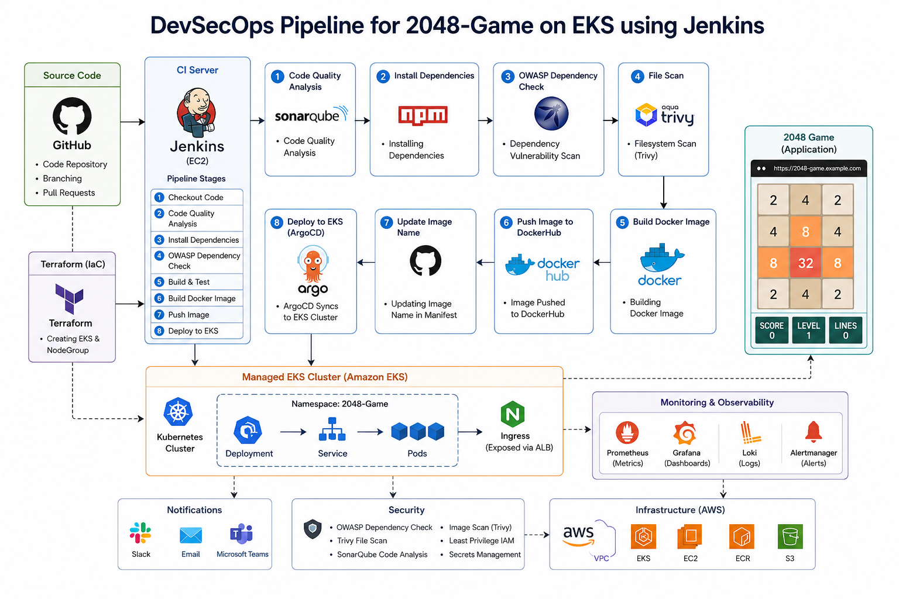
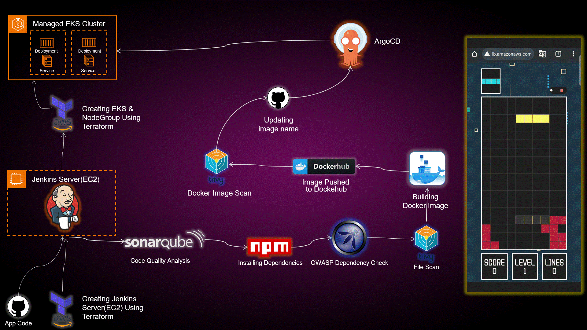
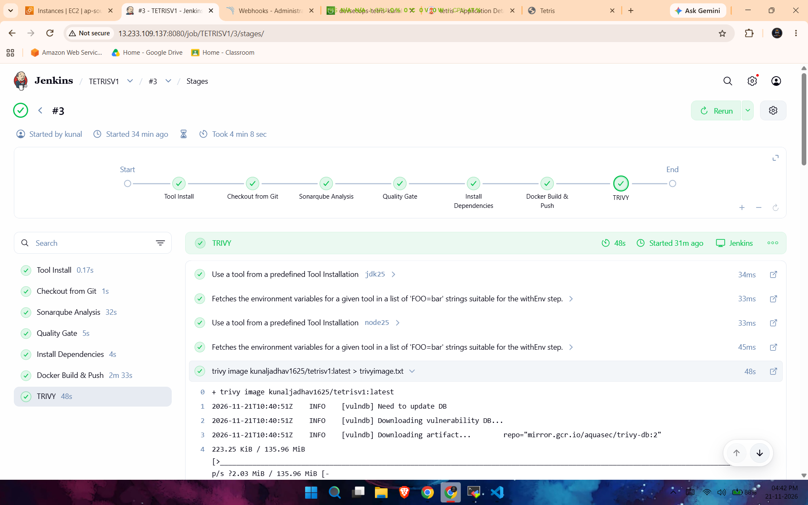
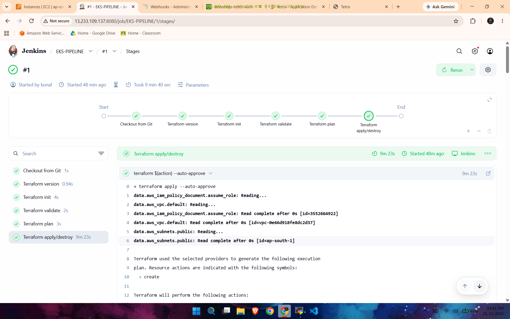
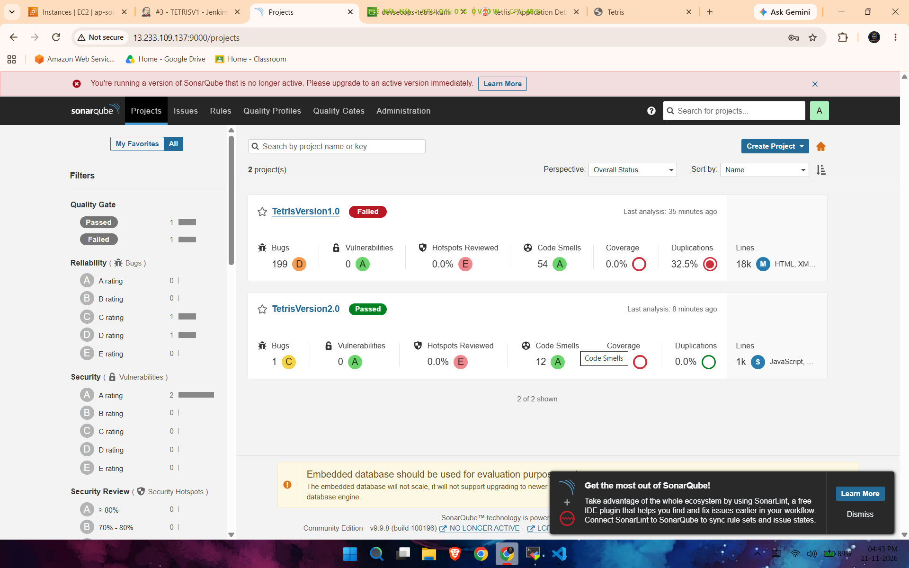
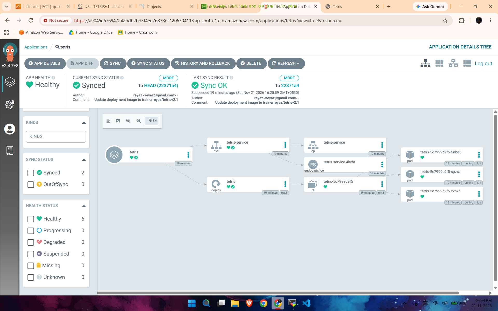
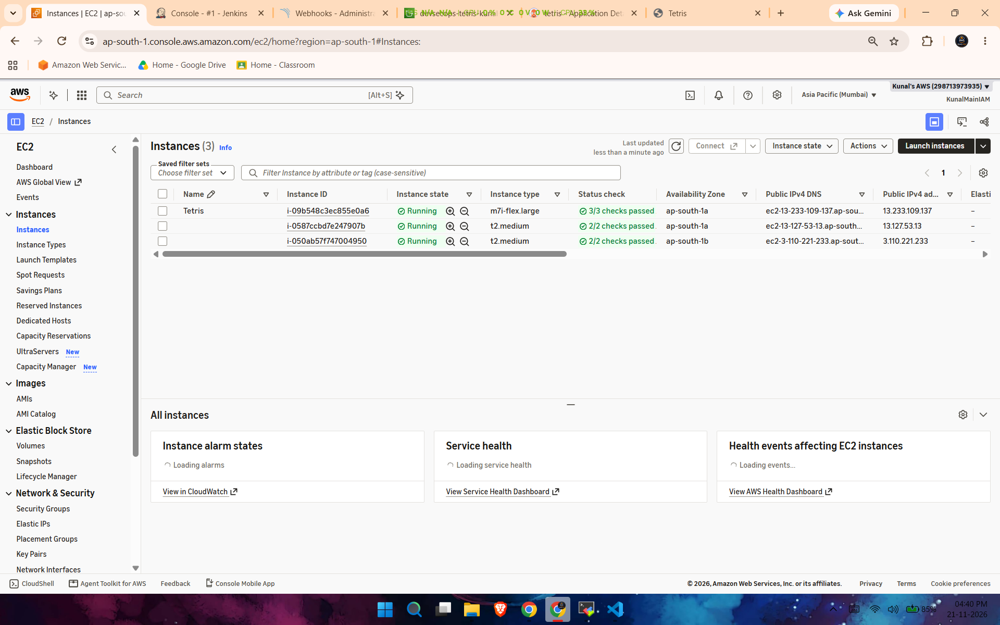
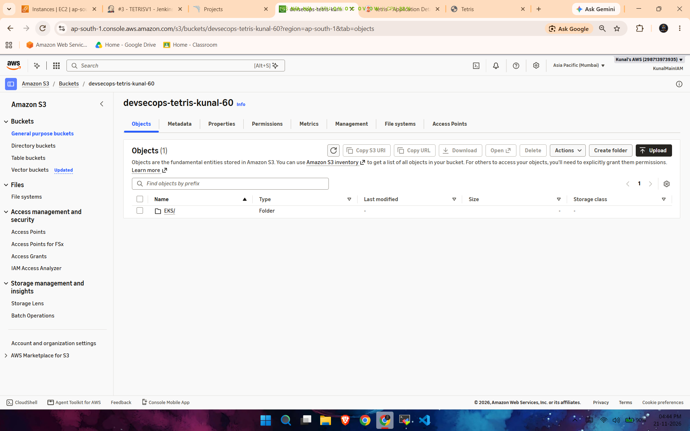
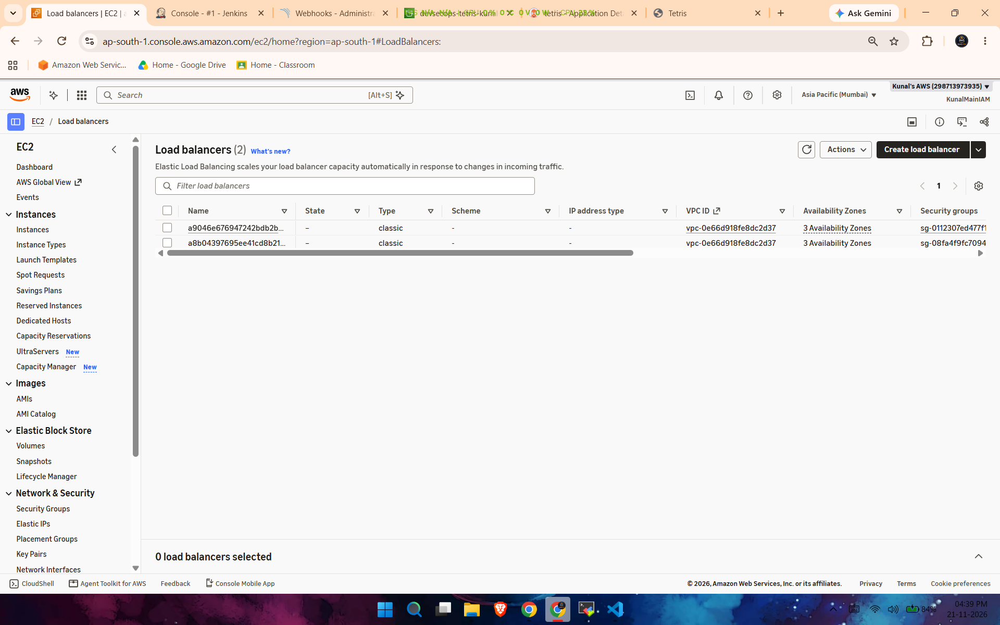

# Tetris DevSecOps on AWS EKS

<div align="center">



**An end-to-end DevSecOps implementation for deploying a containerized Tetris application on Amazon EKS**

[](https://aws.amazon.com/eks/)
[](https://www.jenkins.io/)
[](https://www.docker.com/)
[](https://www.terraform.io/)
[](https://kubernetes.io/)
[](https://argo-cd.readthedocs.io/)
[](https://www.sonarsource.com/products/sonarqube/)
[](https://trivy.dev/)

</div>

---

## Overview

This project demonstrates a production-style DevSecOps workflow for a Tetris game:

```text
GitHub Source
      |
      v
Jenkins CI (EC2)
      |
      +--> SonarQube static analysis
      +--> Trivy filesystem and image scans
      +--> Docker build and push
      |
      v
GitOps Manifest Repository
      |
      v
Argo CD
      |
      v
Amazon EKS
      |
      v
Kubernetes Service / Load Balancer
```

The application repository is built by Jenkins, while a separate manifest repository stores the Kubernetes deployment and desired container image. Argo CD continuously reconciles the cluster with that repository.

> **Repository note:** This repository documents and demonstrates the CI/CD setup, infrastructure workflow, pipeline examples, and screenshots. Application and Kubernetes manifest source repositories are referenced separately by the pipeline.

---

## Architecture

### High-level architecture



### Components

| Component | Purpose |
|---|---|
| Amazon EC2 | Jenkins controller and build worker |
| Jenkins | Orchestrates build, quality, security, and GitOps stages |
| SonarQube | Performs static code analysis and enforces a quality gate |
| Trivy | Scans source files and container images for vulnerabilities |
| Docker / Docker Hub | Builds and distributes versioned application images |
| Terraform | Provisions the Amazon EKS infrastructure |
| Amazon EKS | Runs the Tetris application workloads |
| Kubernetes | Manages deployments, services, pods, and scaling |
| Argo CD | Implements continuous GitOps deployment |
| AWS IAM | Controls access to AWS resources |
| AWS S3 | Stores Terraform remote state |
| AWS Load Balancer | Exposes the application externally |

---

## DevSecOps Pipeline

### Jenkins CI stages

1. Clean the Jenkins workspace
2. Check out the application source
3. Run SonarQube static analysis
4. Evaluate the SonarQube quality gate
5. Install Node.js dependencies
6. Scan the project filesystem with Trivy
7. Build and push a versioned Docker image
8. Scan the container image with Trivy
9. Update the Kubernetes manifest with the new image tag
10. Commit and push the manifest change
11. Allow Argo CD to synchronize the change to EKS

The pipeline uses Jenkins build variables to produce an image tag such as:

```text
<docker-user>/tetrisv2:<BUILD_NUMBER>
```

Example Jenkins pipeline is available in [`Tetrispipeline-github issue-resolved.txt`](Tetrispipeline-github%20issue-resolved.txt).

---

## Infrastructure

Terraform is used to create and manage the EKS environment. The infrastructure workflow is:

1. Update the Terraform backend bucket name
2. Configure Terraform in Jenkins
3. Initialize the Terraform working directory
4. Validate the configuration
5. Preview changes with `terraform plan`
6. Apply or destroy infrastructure using a Jenkins parameter

The Jenkins parameter commonly used is:

```text
action = apply
action = destroy
```

---

## Prerequisites

### AWS

- AWS account
- IAM principal with permission to create EKS and supporting resources
- AWS CLI configured on the Jenkins/EC2 host
- An S3 bucket for Terraform state

### Jenkins host

- Ubuntu 24.04 EC2 instance
- Java 21 or the Jenkins-compatible JDK required by the environment
- Jenkins
- Docker
- Terraform
- kubectl
- AWS CLI
- Trivy
- Sonar Scanner
- Jenkins Node.js plugin/configuration

### Jenkins integrations

- Docker registry credentials
- GitHub credentials or a fine-grained personal access token
- SonarQube server credentials
- SonarQube scanner installation
- Jenkins credential entries for Docker, GitHub, and SonarQube

---

## Security and Credential Management

Do not commit AWS keys, GitHub tokens, Docker credentials, Jenkins secrets, or private configuration files.

Use Jenkins credentials providers and environment-specific secret stores:

| Secret | Recommended Jenkins credential |
|---|---|
| Docker Hub username/token | Secret text or Docker registry credentials |
| GitHub token | Secret text |
| SonarQube token | Secret text |
| AWS credentials | IAM role on EC2 or AWS secrets integration |

If an EC2 instance is used as the Jenkins runner, attach an IAM role with only the permissions required for Terraform and EKS operations rather than embedding access keys in scripts or pipeline files.

After cloning or working with this project, verify for accidental secrets:

```bash
git grep -n -E "(AKIA|GH[PT]_[A-Za-z0-9]|BEGIN .*PRIVATE KEY|password[[:space:]]*=)"
```

---

## Setup Guide

### 1. Provision Jenkins infrastructure

Launch an Ubuntu EC2 instance with sufficient storage and attach an IAM role for AWS operations. Open only the required inbound ports for Jenkins and SonarQube.

Install Java, Docker, Jenkins, Terraform, kubectl, AWS CLI, and Trivy on the instance.

### 2. Start SonarQube

```bash
sudo systemctl restart docker
sudo chmod 777 /var/run/docker.sock

docker run -d \
  --name sonar \
  -p 9000:9000 \
  sonarqube:lts-community
```

Open `http://<EC2-PUBLIC-IP>:9000` and replace the initial administrator password.

### 3. Configure Jenkins

Configure Jenkins tools and credentials:

- JDK
- Node.js
- Sonar Scanner
- Terraform
- Docker registry
- GitHub
- SonarQube server

Create separate Jenkins pipeline jobs for:

- EKS infrastructure provisioning
- Tetris application CI/CD

### 4. Deploy the EKS cluster

1. Create or select an S3 bucket for Terraform state.
2. Update `backend.tf` with the bucket name and AWS region.
3. Run the EKS provisioning pipeline with `action=apply`.
4. Verify the cluster:

```bash
aws eks update-kubeconfig --region <AWS_REGION> --name <EKS_CLUSTER_NAME>
kubectl get nodes
kubectl get namespaces
```

### 5. Install Argo CD

```bash
kubectl create namespace argocd

kubectl apply -n argocd \
  -f https://raw.githubusercontent.com/argoproj/argo-cd/stable/manifests/install.yaml

kubectl get pods -n argocd
kubectl get svc -n argocd
```

To access the Argo CD UI:

```bash
kubectl port-forward svc/argocd-server -n argocd 8080:443
```

Retrieve the initial administrator password:

```bash
kubectl -n argocd get secret argocd-initial-admin-secret \
  -o jsonpath="{.data.password}" | base64 --decode
```

Then open `https://localhost:8080`.

### 6. Create the Argo CD application

Configure an Argo CD application that points to the manifest repository and the Kubernetes manifest path:

```text
Repository URL: <manifest-repository-url>
Revision: main
Path: <manifest-directory>
Namespace: <application-namespace>
Sync Policy: Automatic
```

Enable self-healing and pruning if they match the intended deployment policy.

### 7. Run the Jenkins application pipeline

The application pipeline should:

1. Build the Tetris application.
2. Run SonarQube analysis.
3. Scan source files with Trivy.
4. Build and push the versioned image.
5. Scan the pushed image.
6. Update `deployment.yml` in the manifest repository.

After the manifest commit is pushed, Argo CD synchronizes the workload to EKS.

---

## Verification

Verify the Kubernetes resources:

```bash
kubectl get pods -A
kubectl get deployments -A
kubectl get services -A
```

For an external LoadBalancer service:

```bash
kubectl get service <SERVICE_NAME> -n <APPLICATION_NAMESPACE> \
  -w
```

Open the application using the assigned external IP or DNS hostname.

---

## Project Structure

```text
.
|-- README.md
|-- architecture.gif
|-- Tetris.png
|-- Deploying TETRIS using CI CD ARGO.txt
|-- Tetrispipeline-github issue-resolved.txt
|-- Screenshoots/
|   |-- Application-pipeline.png
|   |-- ArgoCD.png
|   |-- EKS-Pipeline.png
|   |-- ec2-instances.png
|   |-- loadbalancer.png
|   |-- s3-bucket.png
|   `-- sonarqube.png
`-- secret.txt
```

> `secret.txt` should not contain credentials. Rotate any credential that may have been stored in it or in Git history, remove the secret data, and add it to `.gitignore`.

---

## Screenshots

### Jenkins application pipeline



### Jenkins EKS provisioning pipeline



### SonarQube



### Argo CD



### AWS EC2



### Terraform backend



### Application load balancer



---

## Operational Notes

- Scan reports should be retained as Jenkins build artifacts where possible.
- SonarQube quality gates can be configured to block or warn, depending on release policy.
- Trivy scans should be reviewed because vulnerability databases change after the initial build.
- Pin Terraform, EKS, Jenkins, Kubernetes, and tool versions for reproducible deployments.
- Keep separate AWS environments and state files for development and production.
- Configure HTTPS and a DNS record for production-facing services.
- Enable cluster autoscaling and pod resource requests/limits for reliable operation.
- Avoid storing live cluster secrets inside Git repositories.

---

## Cleanup

Destroy application infrastructure and supporting AWS resources before removing the Jenkins host:

```bash
terraform destroy
```

Before destruction, remove or confirm any independently created resources such as:

- EKS cluster
- EC2 instances
- Load balancers
- Elastic IP addresses
- S3 Terraform state
- CloudWatch resources
- Container registries

---

## Reference Pipeline

The complete Jenkins examples and troubleshooting notes are in:

- [`Deploying TETRIS using CI CD ARGO.txt`](Deploying%20TETRIS%20using%20CI%20CD%20ARGO.txt)
- [`Tetrispipeline-github issue-resolved.txt`](Tetrispipeline-github%20issue-resolved.txt)

Before using a pipeline example, replace placeholder repository names, Docker Hub users, Jenkins credential IDs, AWS region values, bucket names, cluster names, and namespace names.
